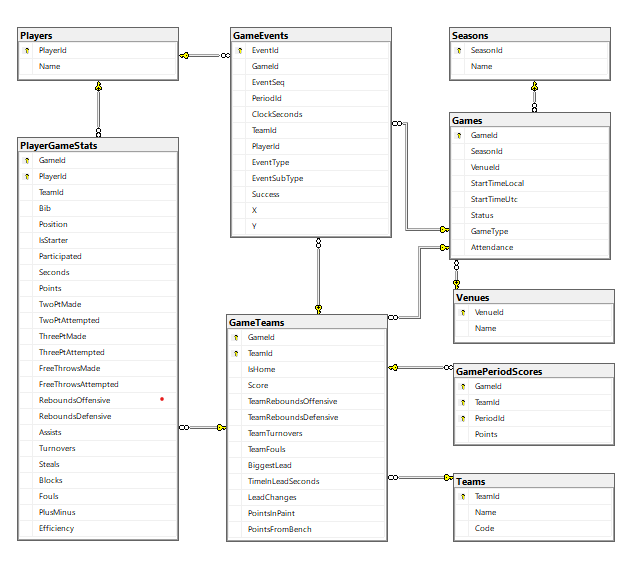

## Mērķis
Uzprojektēt MS SQL Server datubāzi, kurā glabāt visas sezonas spēles.

## Ko darīju
- izveidoju datubāzi NBL
- Izveidoju 9 tabulas.
- ER diagramma SSMS.

## Tabulas
| Tabula | Ieraksta| Primārā atslēga |
|---|---|---|
| Seasons | sezonu | SeasonId |
| Teams | komandu | TeamId |
| Venues | zāli | VenueId |
| Players | spēlētāju | PlayerId |
| Games | spēli | GameId |
| GameTeams | komandu vienā spēlē | GameId + TeamId |
| PlayerGameStats | spēlētāju vienā spēlē | GameId + PlayerId |
| GamePeriodScores | komandas punktus vienā periodā | GameId + TeamId + PeriodId |
| GameEvents | spēles notikumu | EventId |

## Lēmumi un kāpēc
- Primārās atslēgas ir esošie Sportradar ID. Tie ir unikāli un nemainīgi, kā arī jau ir datos.
- GameTeams katrai komandai spēlē ir savs rezultāts, statistika un vaicājumi total ir vienkāršāki. UNIQUE (GameId, IsHome) nodrošina tieši vienu mājinieku komandu.
- Players tabulā ir tikai nemainīgie dati. Numurs, pozīcija un komanda var mainīties, tāpēc tie ir PlayerGameStats tabulā.
- Glabā tikai to, ko nevar aprēķināt. Procenti un kopsummas tiek aprēķināti skatos. GameTeams glabā tikai extra, kas ir statistika bez spēlētāja, un spēles rādītājus.
- Periodi rindās, nevis papildus kolonna, jo pagarinājumu skaits mainās. Sportradar pagarinājumus numurē 11, 12...
- Venues kā atsevišķa tabula normalizācijai. Nākotnē iespēja analizēt mājas laukuma priekšrocību un skatītāju ietekmi.
- EventSeq notikumiem, jo EventId nav sakārtots, bet notikumu secība ir svarīga, piemēram, piespēle seko metienam.
- Datu kvalitāte datubāzē pašā. Pārbauda trāpījumi mazāki vai vienādi par metieniem, nenegatīvas vērtības, atļautie periodi, pulkstenis 0–600. Salikta FK (GameId, TeamId) iekš GameTeams nodrošina, ka spēlētāja un notikuma komanda tiešām piedalījās spēlē. FK GameEvents uz Games pievienota atsevišķi, jo, ja TeamId ir NULL, salikta FK netiktu pārbaudīta.
- Unicode latviešu burtiem.